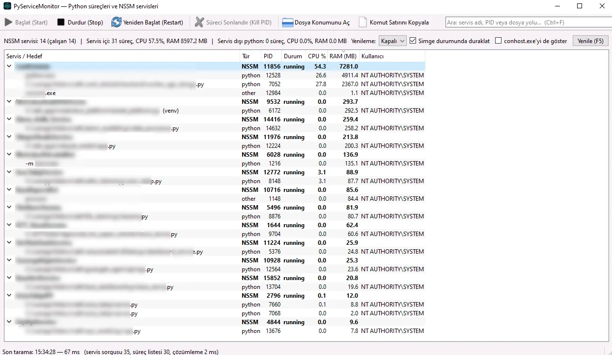

<div align="center">


# PyServiceMonitor

**Windows'ta Python süreçlerini ve NSSM servislerini tek ekranda izleyen, portsuz masaüstü uygulaması.**
*A port-less desktop tool that shows which Python script runs under which NSSM service — with CPU/RAM — on one screen.*

[Türkçe](#türkçe) · [English](#english)

</div>


 -->

---

## Türkçe

### Ne işe yarar?

Sunucuda birden fazla Python betiği NSSM servisi olarak çalışıyorsa Görev Yöneticisi yalnızca bir sürü `python.exe` gösterir. PyServiceMonitor şu soruları tek ekranda yanıtlar:

- Hangi **PID** hangi **`.py` dosyasını** çalıştırıyor?
- Bu süreç hangi **NSSM servisine** ait?
- Her biri ne kadar **CPU / RAM** tüketiyor?
- Hiçbir servise bağlı olmayan, elle başlatılmış Python betikleri hangileri?

Uygulama **hiçbir TCP/UDP portu dinlemez** ve ağ bağlantısı kurmaz. XAMPP gibi birçok portun dolu olduğu sunucularda web paneli yerine tamamen yerel bir masaüstü penceresi olarak çalışır.

### Özellikler

- **Servis → süreç ağacı:** her NSSM servisi, altındaki süreçlerle birlikte listelenir. Servis dışı Python betikleri ayrı bir grupta toplanır.
- **Doğru eşleştirme:** NSSM yapılandırması registry'den okunur (`nssm.exe` çağrılmaz); süreçler ata (PPID) zinciri üzerinden servise bağlanır. PID yeniden kullanımına karşı `create_time` kontrolü yapılır.
- **venv desteği:** venv/`py.exe` launcher'ı ile gerçek yorumlayıcı tek satırda birleştirilir (CPU/RAM toplanır).
- **Servis toplamları:** `conhost.exe` gibi gürültü süreçleri listede gizlenebilir ama servis toplamlarına dahil edilir.
- **Canlı yenileme:** Kapalı / 2 / 5 / 10 / 30 sn, simge durumunda otomatik duraklatma; tarama bitmeden yenisi başlamaz.
- **Hızlı arama:** servis adı, PID veya dosya yolu (`Ctrl+F`).
- **Yönetim eylemleri** (araç çubuğu ve sağ tık menüsü, onay penceresiyle):
  - NSSM servisi için **Başlat / Durdur / Yeniden Başlat**
  - Servis dışı Python süreci için **Süreci Sonlandır** (alt süreçleriyle birlikte)
  - **Dosya Konumunu Aç** (Explorer'da dosyayı seçili açar) ve **Komut Satırını Kopyala**
- **Tek dosya `.exe`:** PyInstaller ile Python kurulu olmayan makinelerde de çalışır.

### Mimari

```
PyServiceMonitor/
├─ app.py              # giriş noktası (PySide6 uygulaması, ikon, AppUserModelID)
├─ core/               # GUI'den bağımsız çekirdek (psutil + registry)
│  ├─ models.py        #   NssmService, ProcessInfo, Snapshot (dataclass'lar)
│  ├─ nssm.py          #   registry'den NSSM yapılandırması + SCM'den durum/PID
│  ├─ processes.py     #   süreç tarama, PPID eşleştirme, venv launcher birleştirme
│  ├─ monitor.py       #   Monitor.snapshot(): servisler + süreçler -> Snapshot
│  └─ control.py       #   start/stop/restart ve süreç sonlandırma
├─ ui/                 # arayüz katmanı
│  ├─ viewmodel.py     #   Snapshot -> ağaç satırları, filtre, sıralama (Qt'siz)
│  ├─ targets.py       #   seçili satır -> hangi eylem uygun, dosya yolu, komut satırı
│  ├─ worker.py        #   tarama ve eylemler için arka plan thread'leri
│  └─ main_window.py   #   ana pencere (QTreeWidget)
├─ assets/             # uygulama ikonu (icon.ico exe için, icon.png pencere için)
└─ build.bat           # PyInstaller ile tek dosya .exe derleme
```

Veri akışı:

```
registry (NSSM ayarları)  ─┐
SCM (durum, nssm.exe PID)  ─┼─►  Monitor.snapshot()  ─►  Snapshot  ─►  viewmodel  ─►  QTreeWidget
psutil (süreç, CPU, RAM)  ─┘        (arka plan thread)
```

`core/` paketi Qt'ye bağımlı değildir; kendi betiklerinizde de kullanabilirsiniz:

```python
from core import Monitor

monitor = Monitor()          # CPU% için aynı nesneyi tekrar kullanın
snap = monitor.snapshot()
for s in snap.services:
    cpu, ram, n = snap.service_usage(s.name)
    print(s.name, s.status, f"{n} süreç, CPU {cpu:.1f}%, RAM {ram:.1f} MB")
```

### Gereksinimler

- Windows (yalnızca Windows'ta çalışır)
- Python 3.12 ile geliştirilip test edildi (3.9+ beklenir, test edilmedi)
- [NSSM](https://nssm.cc/) ile kurulmuş servisler (NSSM servisleri `ImagePath` değerinde `nssm*.exe` geçmesiyle tanınır)
- Tüm süreçlerin komut satırını ve servis kontrolünü kullanmak için **yönetici hakları**

### Kurulum ve çalıştırma

```bat
git clone https://github.com
cd PyServiceMonitor 
python -m pip install -r requirements.txt
python app.py
```

Yönetici olarak çalıştırmazsanız başka kullanıcıların süreçlerinin komut satırı okunamayabilir ve servis eylemleri başarısız olabilir; uygulama bunu başlıkta ve durum çubuğunda belirtir.

### `.exe` derleme

```bat
build.bat
```

Betik bağımlılıkları kurar ve şunu çalıştırır:

```bat
python -m PyInstaller --noconfirm --clean --onefile --windowed --uac-admin ^
    --name PyServiceMonitor --icon "assets\icon.ico" ^
    --add-data "assets\icon.png;assets" --exclude-module tkinter app.py
```

Çıktı: `dist\PyServiceMonitor.exe`

- `--onefile`: tek dosya; her açılışta geçici klasöre açıldığı için ilk pencere birkaç saniye geç gelebilir.
- `--uac-admin`: açılışta UAC onayı ister. Konsoldan doğrudan başlatırsanız "elevation gerekli" hatası alabilirsiniz; çift tıklayın veya yönetici konsoldan açın.
- Tek dosya + UAC isteyen `.exe`'leri bazı antivirüs/EDR ürünleri şüpheli bulabilir; gerekirse imzalayın veya istisna tanımlayın.
- Hedef makinede Python kurulu olmasına gerek yoktur (izlenen betiklerin kendi Python'u elbette gerekir).

### Güvenlik notları

- Uygulama registry'ye **yazmaz**; NSSM ayarlarını yalnızca okur.
- Servis başlat/durdur işlemleri `net start` / `net stop` ile, süreç sonlandırma `psutil` ile yapılır. Hepsi onay penceresi ister (varsayılan seçenek "Hayır").
- "Süreci Sonlandır" yalnızca **servis dışı** Python süreçlerinde aktiftir; servis altındaki süreçler servis üzerinden yönetilir.
- Sonlandırma zorla kapatmadır; kaydedilmemiş veri kaybolabilir. Üretim sistemlerinde önce bir test betiğiyle deneyin.

### Bilinen sınırlamalar

- Yalnızca Windows.
- Yalnızca NSSM servisleri tanınır (diğer Windows servisleri listelenmez).
- NSSM yapılandırması 30 sn önbelleğe alınır; yeni kurulan bir servis en fazla bu süre gecikmeyle görünür.
- İlk taramada CPU ölçümü için yaklaşık 1 sn beklenir; sonraki taramalar beklemez.
- Depoda otomatik birim testi yoktur; katkılar memnuniyetle karşılanır.

### Katkı ve lisans

Hata bildirimleri ve pull request'ler memnuniyetle karşılanır. Lisans: [MIT](LICENSE).

---

## English

### What is it?

When several Python scripts run as NSSM services on a Windows server, Task Manager just shows a pile of `python.exe`. PyServiceMonitor answers, on one screen:

- Which **PID** runs which **`.py` file**?
- Which **NSSM service** does that process belong to?
- How much **CPU / RAM** does each one use?
- Which Python scripts were started by hand and belong to no service?

It **opens no TCP/UDP port** and makes no network connections. It is a plain local desktop window, built for servers where ports are already taken (e.g. a XAMPP box) and a web dashboard is not an option.

### Features

- **Service → process tree**; standalone Python scripts are grouped separately.
- **Reliable matching:** NSSM configuration is read from the registry (no `nssm.exe` calls); processes are tied to services through the parent-PID chain, with a `create_time` guard against PID reuse.
- **venv aware:** a venv / `py.exe` launcher and the real interpreter are merged into one row (CPU/RAM summed).
- **Accurate totals:** noise processes such as `conhost.exe` can be hidden from the list but still count towards service totals.
- **Live refresh:** Off / 2 / 5 / 10 / 30 s, auto-pause when minimized, never overlapping scans.
- **Instant search** by service name, PID or file path (`Ctrl+F`).
- **Management actions** (toolbar and context menu, with confirmation):
  - NSSM service: **Start / Stop / Restart**
  - Standalone Python process: **Kill** (including child processes)
  - **Open file location** (selects the file in Explorer) and **Copy command line**
- **Single-file `.exe`** via PyInstaller; no Python needed on the target machine.

### Architecture

See the tree in the Turkish section above. In short: `core/` is a Qt-free engine (registry + psutil + SCM) that produces a `Snapshot`; `ui/` turns snapshots into tree rows (`viewmodel.py`, testable without Qt) and renders them with PySide6; scans and actions run on background threads so the UI never freezes.

```python
from core import Monitor

monitor = Monitor()          # reuse the same object for meaningful CPU%
snap = monitor.snapshot()
for s in snap.services:
    cpu, ram, n = snap.service_usage(s.name)
    print(s.name, s.status, f"{n} processes, CPU {cpu:.1f}%, RAM {ram:.1f} MB")
```

### Requirements

- Windows only
- Developed and tested with Python 3.12 (3.9+ expected, untested)
- Services installed with [NSSM](https://nssm.cc/) (recognised by `nssm*.exe` in the service `ImagePath`)
- **Administrator rights** recommended: needed to read other users' command lines and to control services

### Install & run

```bat
git clone <repo-url>
cd <repo>
python -m pip install -r requirements.txt
python app.py
```

### Build the `.exe`

```bat
build.bat
```

Produces `dist\PyServiceMonitor.exe` (`--onefile --windowed --uac-admin`). Notes:

- The single-file build unpacks to a temp folder on each launch, so the first window can take a few seconds.
- `--uac-admin` triggers a UAC prompt; launch by double-click or from an elevated console.
- Single-file executables that request elevation may be flagged by some antivirus/EDR products.

### Safety

- The app never **writes** to the registry.
- Service control uses `net start` / `net stop`; process termination uses `psutil`. Every action asks for confirmation (default answer: "No").
- Kill is enabled only for **standalone** Python processes; processes under a service are managed through the service.
- Termination is forceful: unsaved data can be lost. Try it on a throwaway script first.

### Known limitations

- Windows only; only NSSM services are recognised.
- NSSM configuration is cached for 30 s, so a newly installed service can take up to that long to appear.
- The first scan waits ~1 s to take a meaningful CPU measurement; later scans don't.
- No automated unit tests yet — contributions welcome.

### License

[MIT](LICENSE)
